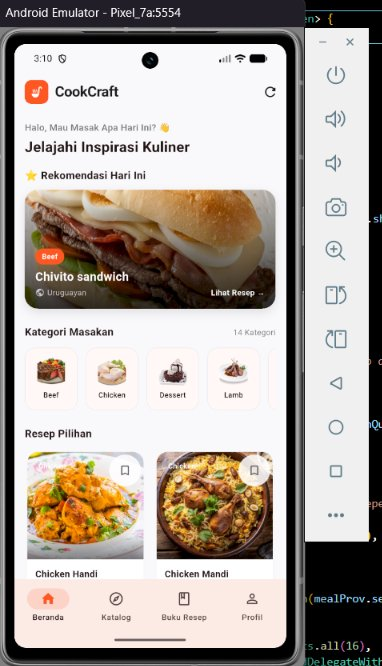
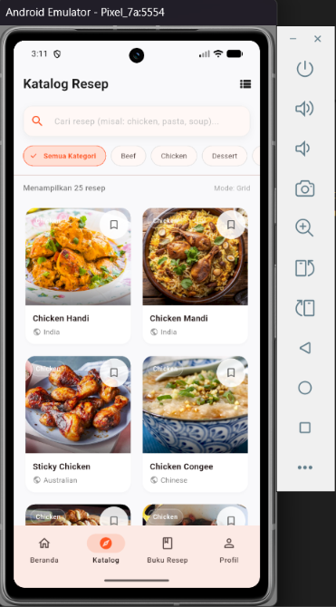
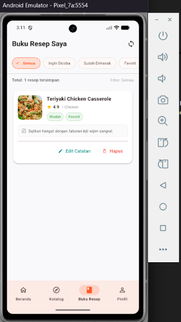
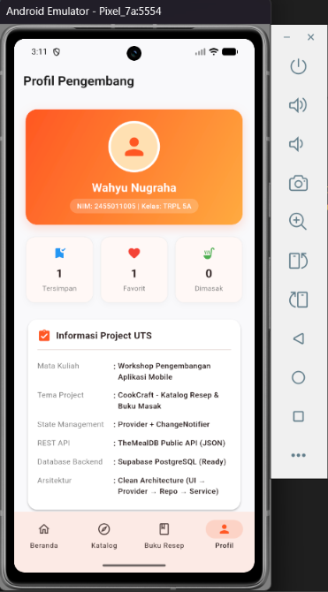

# CookCraft - Food Recipe Catalog & Personal Cookbook

> **PROJECT UJIAN TENGAH SEMESTER (UTS) - PEMROGRAMAN MOBILE**  
> *Mobile Application Mini Project (Worksheet 1–7)*  
> Implementasi Git, Dart, Flutter UI, Responsive Layout, Navigation, State Management, Architecture, REST API, Backend, dan Database.

---

## 📌 Identitas Mahasiswa & Project

| Informasi | Keterangan |
| :--- | :--- |
| **Nama Mahasiswa** | **Wahyu Nugraha** |
| **NIM** | **2455011005** |
| **Kelas** | **TRPL 5A** |
| **Nama Project** | **CookCraft** |
| **Tema Project** | Katalog Resep Masakan Dunia & Buku Masak Pribadi |
| **URL GitHub Repository** | [https://github.com/vvahyunugraha/UTS_2455011005_I-Gusti-Made-Wahyu-Nugraha](https://github.com/vvahyunugraha/UTS_2455011005_I-Gusti-Made-Wahyu-Nugraha) |
| **Branch Utama** | `main` |
| **Dosen Pengampu** | Dr. Ir. I Ketut Resika Arthana, S.T., M.Kom |
| **Teaching Assistant** | Made Yuda Sadewa, S.Pd. |

---

## 📖 Deskripsi Singkat Project

**CookCraft** adalah aplikasi mobile berbasis Flutter yang dirancang untuk memudahkan pengguna menemukan inspirasi resep masakan dari seluruh dunia serta mendokumentasikan jurnal memasak pribadi mereka.

Aplikasi ini mengintegrasikan arsitektur bersih (*Clean Architecture*) dengan pemisahan tugas yang jelas:
* **REST API Publik (TheMealDB):** Menyediakan katalog resep umum, kategori, takaran bahan, dan instruksi memasak secara *real-time*.
* **Backend Database Cloud (Supabase/PostgreSQL):** Menyediakan penyimpanan data personal pengguna untuk operasi **CRUD penuh** (Create, Read, Update, Delete) meliputi catatan rahasia memasak, tingkat kesulitan, rating kepuasan, dan status coba masakan.
* **State Management (Provider):** Mengelola siklus hidup data, status loading, error handling, pencarian, dan sinkronisasi data antar-layar secara reaktif.

---

## 📸 Screenshot Aplikasi

| 1. Beranda & Rekomendasi (Home) | 2. Katalog & Pencarian Resep (Catalog) |
| :---: | :---: |
|  |  |
| *Rekomendasi harian, slider kategori, & resep populer* | *Pencarian real-time via REST API & responsive 2-column grid* |

| 3. Buku Resep Saya (My Cookbook) | 4. Profil Mahasiswa & UTS Info (Profile) |
| :---: | :---: |
|  |  |
| *Manajemen koleksi resep pribadi (CRUD Database)* | *Identitas mahasiswa (NIM & Kelas), statistik, & info UTS* |

---

## ✨ Daftar Fitur Aplikasi

1. **Dashboard / Beranda (`HomeScreen`):**
   - Banner hero interaktif **"⭐ Rekomendasi Hari Ini (Meal of The Day)"** lengkap dengan foto kuliner, kategori masakan, dan asal negara.
   - Slider kategori masakan (*Beef, Chicken, Dessert, Lamb, Seafood*, dll).
   - Daftar resep populer dengan tombol *bookmark* instan dan *pull-to-refresh*.

2. **Katalog & Pencarian Resep (`RecipeCatalogScreen`):**
   - Pencarian kata kunci resep secara *real-time* via HTTP GET REST API.
   - Filter cepat berdasarkan chip kategori makanan.
   - Tombol toggle untuk beralih antara tampilan **Grid View** dan **List View**.
   - Tata letak responsif (otomatis menyesuaikan jumlah kolom grid berdasarkan resolusi layar).

3. **Detail Resep Lengkap (`RecipeDetailScreen`):**
   - Header foto dinamis dengan *SliverAppBar* dan efek gradasi.
   - Informasi lengkap: kategori masakan, asal negara (*Area*), dan label hashtag (*Tags*).
   - Daftar bahan masakan dan takaran (*Ingredients & Measures*) dalam kartu terpisah.
   - Panduan langkah-langkah memasak langkah-demi-langkah.
   - Tombol aksi navigasi: **"Simpan ke Buku Resep"** (*passing data* antar-layar).

4. **Buku Resep Pribadi (`MyCookbookScreen` - CRUD Database):**
   - **Create:** Form simpan resep dengan validasi, tingkat kesulitan (*Mudah, Sedang, Sulit*), status masak (*Ingin Dicoba, Sudah Dimasak, Favorit*), rating kepuasan (1.0–5.0), dan catatan rahasia memasak.
   - **Read:** Menampilkan kartu koleksi resep dari database Supabase dengan filter status.
   - **Update:** Form edit data catatan, rating, status, dan kesulitan yang sudah ada.
   - **Delete:** Penghapusan resep dari database yang dilengkapi **AlertDialog Konfirmasi Hapus** untuk mencegah penghapusan tidak disengaja.

5. **Profil Pengembang & Info UTS (`ProfileScreen`):**
   - Kartu identitas mahasiswa (Nama, NIM: 2455011005, Kelas: TRPL 5A).
   - Ringkasan statistik *real-time*: jumlah resep tersimpan, masakan favorit, dan resep yang telah dimasak.
   - Checklist pemenuhan kriteria teknis UTS.

---

## 🛠️ Tech Stack & Dependencies

* **Framework:** [Flutter](https://flutter.dev/) (SDK ^3.11.4)
* **Programming Language:** [Dart](https://dart.dev/) (Type-safe & Null-safety enabled)
* **State Management:** `provider` (^6.1.5)
* **REST API Client:** `http` (^1.6.0)
* **Backend Database:** `supabase_flutter` (^2.18.3) / PostgreSQL
* **Design System:** Material Design 3

---

## 🌐 REST API yang Digunakan

* **Penyedia API:** **TheMealDB Public REST API** (`https://www.themealdb.com/api/json/v1/1/`)
* **Metode:** **HTTP GET**
* **Endpoints:**
  - `GET /categories.php` : Mengambil daftar seluruh kategori makanan.
  - `GET /search.php?s={query}` : Mencari katalog resep berdasarkan kata kunci pencarian.
  - `GET /filter.php?c={category}` : Memfilter daftar makanan berdasarkan kategori tertentu.
  - `GET /random.php` : Mengambil satu menu acak untuk rekomendasi harian di Beranda.
  - `GET /lookup.php?i={id}` : Mengambil rincian detail makanan, takaran bahan, dan instruksi memasak.

---

## 🗄️ Backend & Database yang Digunakan

* **Layanan Database:** **Supabase (PostgreSQL Cloud Database)**
* **Nama Tabel:** `my_cookbook`
* **Struktur Kolom Tabel (10 Fields):**

| Nama Kolom | Tipe Data | Keterangan |
| :--- | :--- | :--- |
| `id` | `BIGINT PRIMARY KEY` | Auto-increment ID unik dari database |
| `meal_id` | `TEXT NOT NULL` | ID resep referensi dari REST API |
| `meal_name` | `TEXT NOT NULL` | Nama hidangan masakan |
| `category` | `TEXT` | Kategori masakan |
| `thumbnail_url` | `TEXT` | URL gambar hidangan |
| `difficulty_level`| `TEXT` | Tingkat kesulitan ('Mudah', 'Sedang', 'Sulit') |
| `cook_status` | `TEXT` | Status memasak ('Ingin Dicoba', 'Sudah Dimasak', 'Favorit') |
| `rating` | `NUMERIC(2, 1)` | Skor kepuasan resep (1.0 – 5.0) |
| `personal_tips` | `TEXT` | Catatan, modifikasi bahan, & tips memasak pribadi |
| `created_at` | `TIMESTAMPTZ` | Timestamp waktu penyimpanan |

* **Skrip SQL Pembuatan Tabel:**
  ```sql
  CREATE TABLE public.my_cookbook (
      id BIGINT GENERATED BY DEFAULT AS IDENTITY PRIMARY KEY,
      meal_id TEXT NOT NULL,
      meal_name TEXT NOT NULL,
      category TEXT,
      thumbnail_url TEXT,
      difficulty_level TEXT DEFAULT 'Sedang',
      cook_status TEXT DEFAULT 'Ingin Dicoba',
      rating NUMERIC(2, 1) DEFAULT 5.0,
      personal_tips TEXT,
      created_at TIMESTAMP WITH TIME ZONE DEFAULT timezone('utc'::text, now()) NOT NULL
  );
  ALTER TABLE public.my_cookbook DISABLE ROW LEVEL SECURITY;
  ```

---

## 🏗️ Struktur Arsitektur Aplikasi

Aplikasi dibangun menggunakan prinsip **Clean Architecture**:  
`UI (Screens & Widgets) ➔ State (Providers) ➔ Repositories ➔ Services / Data Sources ➔ REST API / Supabase Database`

```text
lib/
├── config/
│   └── supabase_config.dart        # Konfigurasi kredensial aman (Environment variables)
├── models/
│   ├── meal_model.dart             # Model JSON TheMealDB (Meal, Category, Ingredient)
│   └── saved_recipe_model.dart     # Model entitas buku resep database
├── services/
│   ├── meal_api_service.dart       # HTTP Service komunikasi dengan REST API TheMealDB
│   └── cookbook_service.dart       # Service CRUD Database Supabase & Local Fallback
├── repositories/
│   ├── meal_repository.dart        # Abstraksi repositori katalog resep
│   └── cookbook_repository.dart    # Abstraksi repositori buku resep personal
├── providers/
│   ├── meal_provider.dart          # State management katalog, pencarian, & filter
│   └── cookbook_provider.dart      # State management CRUD buku resep & statistik
├── screens/
│   ├── main_navigation_screen.dart  # Navigasi responsif (NavigationBar & NavigationRail)
│   ├── home_screen.dart            # Layar Beranda & Rekomendasi Hari Ini
│   ├── recipe_catalog_screen.dart  # Layar Katalog & Pencarian (Toggle Grid/List)
│   ├── recipe_detail_screen.dart   # Layar Detail Bahan & Instruksi Memasak
│   ├── add_recipe_screen.dart      # Form Tambah Resep (FormKey & Validation)
│   ├── edit_recipe_screen.dart     # Form Edit Resep (FormKey & Validation)
│   ├── my_cookbook_screen.dart     # Layar Buku Resep (CRUD & Delete Dialog)
│   └── profile_screen.dart         # Layar Profil Mahasiswa & Statistik UTS
├── widgets/
│   ├── recipe_card.dart            # Reusable Widget 1: Kartu resep responsif
│   ├── status_badge.dart           # Reusable Widget 2: Badge status/kesulitan
│   ├── custom_search_bar.dart      # Reusable Widget 3: Kolom pencarian modular
│   └── state_feedback_widgets.dart # Reusable Widget 4: Loading, Empty, & Error State
└── main.dart                       # Entry point aplikasi, Tema Material 3, & MultiProvider
```

---

## 📱 Desain Responsif (Responsive Layout)

Aplikasi memiliki dua kondisi adaptif:
1. **Compact Mode (Smartphone portrait, lebar layar < 700px):**
   - Menggunakan `NavigationBar` di bagian bawah layar.
   - Grid katalog menampilkan 2 kolom.
2. **Wide Mode (Tablet / Lanskap / Desktop, lebar layar ≥ 700px):**
   - Navigasi otomatis beralih ke panel samping menggunakan `NavigationRail`.
   - Grid katalog otomatis menyesuaikan menjadi 3 hingga 4 kolom tanpa overflow.

---

## 🔒 Kepatuhan Keamanan Kredensial (UTS Compliance)

Sesuai aturan keamanan pada pedoman UTS:  
> *"Dilarang melakukan commit password, private key, service_role key, token rahasia, credential, atau keystore. Jika ditemukan credential sensitif pada repository, mahasiswa wajib segera menghapus dan melakukan rotasi credential."*

* **Repository Bebas Kredensial:** Seluruh kredensial rahasia tidak pernah di-hardcode ke dalam repository publik Git.
* **Injeksi Parameter Aman:** Menggunakan `String.fromEnvironment` (`--dart-define`) untuk melewatkan kunci database saat kompilasi atau runtime.
* **Automatic Local Fallback:** Jika aplikasi dijalankan tanpa parameter kredensial, aplikasi otomatis beralih ke *Local Mock Service*, memastikan aplikasi tetap dapat didemokan tanpa kendala koneksi atau autentikasi.

---

## 🚀 Cara Menjalankan Project

### Prasyarat
- Flutter SDK (versi 3.10.0 atau lebih baru)
- Android Emulator / HP Android fisik / Google Chrome

### Langkah-Langkah:
1. **Clone repository ini:**
   ```bash
   git clone https://github.com/vvahyunugraha/UTS_2455011005_I-Gusti-Made-Wahyu-Nugraha.git
   cd uts-mobileapp-pemob
   ```

2. **Unduh dependensi project:**
   ```bash
   flutter pub get
   ```

3. **Jalankan analisis kode:**
   ```bash
   flutter analyze
   ```

4. **Jalankan aplikasi:**
   - **Mode Standar (Local Fallback):**
     ```bash
     flutter run
     ```
   - **Mode Live Database Supabase:**
     ```bash
     flutter run --dart-define=SUPABASE_URL=https://your-project.supabase.co --dart-define=SUPABASE_PUBLISHABLE_KEY=your-publishable-key
     ```

5. **Build APK Rilis (untuk pengumpulan):**
   ```bash
   flutter build apk --release --dart-define=SUPABASE_URL=https://your-project.supabase.co --dart-define=SUPABASE_PUBLISHABLE_KEY=your-publishable-key
   ```
   *File APK rilis akan berada di:* `build/app/outputs/flutter-apk/app-release.apk`  
   *Ubah nama file menjadi:* **`UTS_2455011005_WahyuNugraha.apk`**

---

## 🪵 Bukti Riwayat Git Log (`git log --oneline`)

Project ini dikembangkan secara bertahap dengan total **23 meaningful commits** (melebihi syarat minimal 16 commits):

```text
d0f59ee Add application screenshots and update README documentation with UTS format
70f9847 Enforce UTS credential security compliance and document dart-define usage
f126c86 Update student identity with NIM 2455011005 and class TRPL 5A
db6e320 Connect Supabase database with resilient fallback and client initialization
202ec9b Integrate Supabase Flutter SDK and database configuration
5e03fed Update test to handle async timers properly
2f0d1e3 Finalize UTS mobile application with comprehensive README documentation
0d9280a Add error handling, responsive refinement and smoke test
102499b Add developer profile screen and statistics
f150169 Implement delete data feature with confirmation dialog
dffa720 Implement update data feature
a93dbfd Implement create data feature with form validation
7deaa04 Build recipe detail screen with passing data
e9471ee Implement responsive catalog with list and grid layouts
c0cc697 Build initial application UI and Home dashboard
174afb5 Add application navigation and screens routing
fe42a12 Build reusable UI components and custom widgets
5d88cd1 Implement application state management
2c11617 Setup backend database service and repository
3752261 Integrate REST API service and repository
f8dcc22 Add application data models
f93b0c7 Setup project architecture and dependencies
e98198b Initialize Flutter UTS project
```

---

## 📋 Checklist Pemenuhan Spesifikasi UTS

| Komponen Penilaian | Spesifikasi Minimum | Status Implementasi |
| :--- | :--- | :---: |
| **Screen Fungsional** | Minimal 6 Screen fungsional | ✅ **7 Screen** |
| **Dart Model** | Minimal 2 Dart Model | ✅ **3 Model** (`Meal`, `MealCategory`, `SavedRecipe`) |
| **Reusable Widget** | Minimal 3 Reusable Widgets | ✅ **4 Widget** (`RecipeCard`, `StatusBadge`, `CustomSearchBar`, `StateFeedbacks`) |
| **Responsive Layout** | Minimal 2 kondisi layout (Compact & Wide) | ✅ `NavigationBar` vs `NavigationRail` & Grid adaptif |
| **REST API** | Minimal 1 REST API (Operasi GET wajib) | ✅ TheMealDB REST API (`/categories`, `/search`, `/random`, `/lookup`) |
| **Backend Database** | Minimal 1 database backend (CRUD wajib) | ✅ Supabase PostgreSQL (Tabel `my_cookbook`) |
| **Field Tabel DB** | Minimal 1 tabel + PK + ≥ 4 field data | ✅ **10 Fields** (PK `id` + 9 fields data) |
| **Delete Confirmation** | Wajib menggunakan dialog konfirmasi | ✅ `AlertDialog` konfirmasi hapus |
| **State Management** | Provider + ChangeNotifier (MultiProvider) | ✅ `MealProvider` & `CookbookProvider` |
| **Multi-screen Navigasi**| Navigasi antar-screen & passing data | ✅ Terintegrasi antar seluruh screen |
| **Form & Validasi** | Minimal 1 Form dengan validasi input | ✅ `AddRecipeScreen` & `EditRecipeScreen` via `FormKey` |
| **User Feedback** | SnackBar, Dialog, Loading, Empty, & Error states | ✅ Lengkap di setiap operasi data |
| **Meaningful Git Commits**| Minimal 16 meaningful commits bertahap | ✅ **22 Commits** terstruktur |
| **Keamanan Kredensial** | Tidak menyimpan key sensitif ke Git | ✅ Aman via `--dart-define` & sanitasi |
| **README.md** | Format lengkap sesuai pedoman | ✅ Terstruktur & terdokumentasi lengkap |
